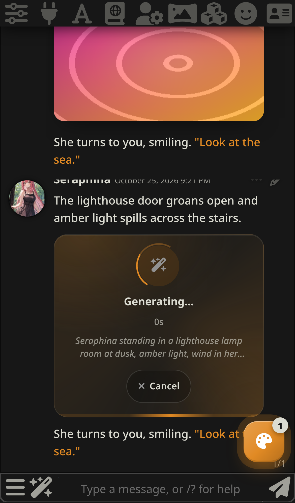
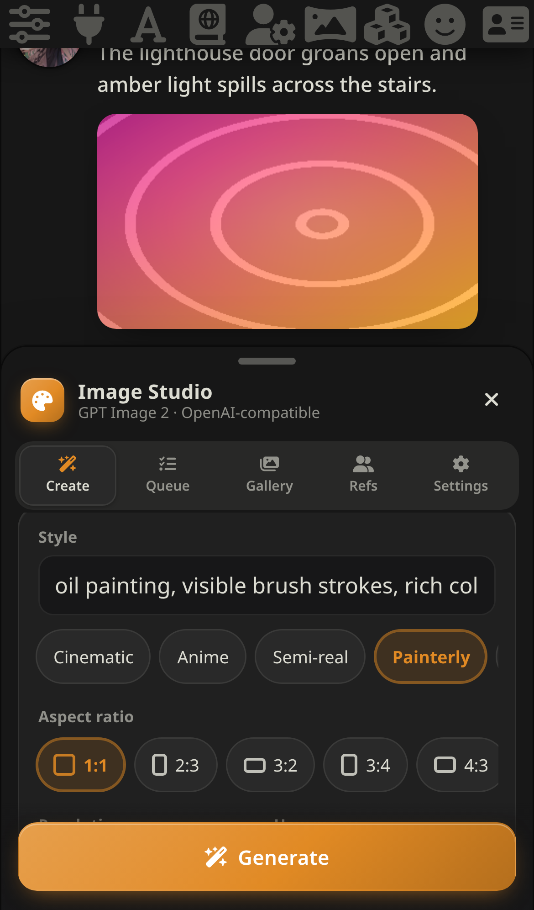
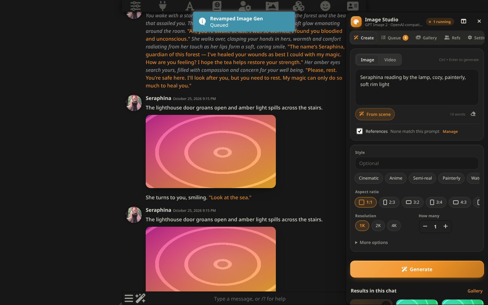
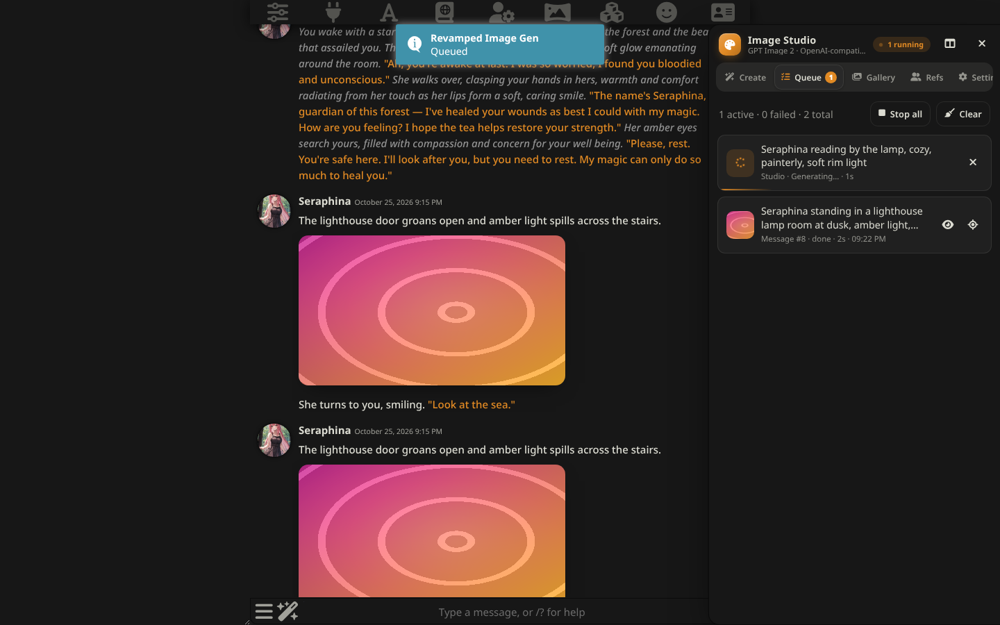

# Revamped Image Gen

Inline image and video generation for [SillyTavern](https://github.com/SillyTavern/SillyTavern), built around a proper **Image Studio panel** that works on phones, tablets and desktops.

The AI writes an image tag in its reply → the extension generates it and drops the picture into the message where the tag was. Everything else (creating images by hand, the queue, a gallery, character references, settings) lives in one panel that shows up as a **bottom sheet on phones** and a **resizable side drawer on tablets and desktops**.

It is a rebuild of [notsosillynotsoimages](https://github.com/aceeenvw/notsosillynotsoimages) by aceeenvw and reads the same tag format, so existing chats and presets keep working.

| Phone — generating in chat | Phone — Studio sheet | Desktop — Create | Desktop — Queue |
|---|---|---|---|
|  |  |  |  |

*(Screenshots are from SillyTavern 1.19 with a mock image provider, so the "art" is generated gradients. Colours follow your SillyTavern theme.)*

---

## Install

1. SillyTavern → **Extensions** → **Install extension**
2. Paste `https://github.com/howardsierra/revampedimagegen` and install.
3. Reload. A round palette button appears above the chat input. Tap it, or press **Alt+I**.

If you used notsosillynotsoimages, open **Settings → Import & diagnostics → Import**. Your connection, presets and character reference photos come across; the photos are reused, not uploaded again. Disable the old extension afterwards so the two don't both process the same tags.

## Quick start

1. **Settings → Connection → Quick setup**: tap **Nano Banana** (Google AI Studio key), **GPT Image** (OpenAI key) or **Both via OpenRouter**. Paste your key, pick a model chip, then tap **Test**.
2. Chat as usual. **AI instructions** are on by default, so the chat model is already told how to write image tags. You don't need to edit your preset.
3. Images show up in the reply as they finish, with a live placeholder (status, elapsed time, Cancel) while they generate.

## Tuned for Nano Banana and GPT Image

The extension knows what each model can do and adjusts every request. Model IDs come from the official SDKs (openai 7.43, @google/genai 2.31).

| Model | IDs | Sizes | Reference photos |
|---|---|---|---|
| Nano Banana | `gemini-2.5-flash-image` | 1K | up to 3 |
| Nano Banana 2 / 2.1 | `gemini-3.1-flash-image`, `gemini-nano-banana-2.1` | 512–4K | 5 people by default, up to 14 images |
| Nano Banana 2 Lite | `gemini-3.1-flash-lite-image` | 512, 1K | up to 3 |
| Nano Banana Pro | `gemini-3-pro-image`, `nano-banana-pro-preview` | 1K, 2K, 4K | 5 people by default, up to 14 images |
| GPT Image 2 / 2.5 | `gpt-image-2`, `gpt-image-2.5-flare`, `gpt-image-2.5-sunburst` | any size up to 3840×2160 | 5 by default, up to 16 |
| GPT Image 1.x | `gpt-image-1.5`, `gpt-image-1`, `gpt-image-1-mini` | 1024 square, 3:2, 2:3 | 4 by default, up to 16 |

- **Nano Banana:**
  - Each reference photo is sent with a label ("Reference image 1 — Elodie:"), so several characters don't blur together.
  - Aspect ratios the model doesn't support are mapped to the nearest one (4:5 → 3:4), and sizes are clamped to what the model can make.
  - Draft "thought" images from thinking models are skipped, so you always get the final picture.
- **GPT Image:**
  - On gpt-image-2 and 2.5, the exact size is computed from your aspect ratio and 1K/2K/4K choice, within OpenAI's limits.
  - Reference photos go to the official `/v1/images/edits` endpoint, with their names listed in order in the prompt.
  - Options: **High input fidelity** (gpt-image-1.x keeps faces closer to the references), **Moderation: low**, and **WebP/JPEG output** for smaller files.
  - Quality offers `xhigh`/`max` on 2.5.
- **Aggregators:** if a proxy rejects one of the newer parameters, it is dropped and the request retried once.
- The **Create** tab greys out sizes the selected model can't produce. **Max photos per image** defaults to the model's sensible limit.

## References per chat, per character, or everywhere

References live in three layers. The most specific one wins:

- **This chat**: only this chat.
- **This character**: every chat with this character card.
- **All chats**: everywhere.

The main character and You come from the most specific layer that has a photo. Extra characters are merged from all three layers.

In the **Refs** tab, pick the layer you're editing. The **Inherited** list shows photos coming from the other layers; in a chat you can **mute** any of them for just that chat.

To lock in a look you like, open any generated image and tap **Use as ref**. Choose the character, or create a new one, and the layer to save it in.

## Regex prompt capture

The AI doesn't have to write HTML. Under **Settings → Prompt capture**, enable a rule and the extension turns matching text in replies into images:

| Rule | The AI writes |
|---|---|
| `[IMG: prompt]` | `[IMG: Lodi on a windy cliff --ar 16:9 --style watercolor]` |
| `<image>prompt</image>` | `<image>Robin under the lanterns --ar 3:4</image>` |
| hidden comment | `<!-- image: a stormy harbour -->` (never visible to the reader) |
| `Image prompt:` line | `**Image prompt:** Elodie laughing in the rain` |
| your own regex | Use the named group `(?<prompt>…)` or the first capture group. Optional groups `(?<style>)`, `(?<ar>)`, `(?<size>)`, `(?<neg>)` fill the other fields. |

- Flags at the end of a prompt are understood: `--ar 16:9`, `--style …`, `--size 2K`, `--no …`, `--seed 42`.
- Text inside existing image tags is never touched.
- A tester shows live what each enabled rule captures from a sample reply.
- **AI instructions → Tell the AI to write** switches the injected instructions to the format you chose. Simple formats are more reliable with smaller models and cost fewer tokens.

## What's new compared to notsosillynotsoimages

**The panel**
- A Studio panel with five tabs (Create, Queue, Gallery, Refs, Settings), replacing the long settings drawer.
- Phones: a bottom sheet you can drag between half and full height, swipe down to close, or tap the handle to toggle. It moves up with the on-screen keyboard so the input stays visible, and respects notches and safe areas.
- Tablets and desktop: a side drawer, left or right, that you resize by dragging its edge (double-click resets it). The header button switches between side and bottom.
- A floating launcher you can drag anywhere. It shows a live count and a spinner ring while jobs run, and remembers where you put it.
- Touch targets are 44px on touch screens, inputs are 16px so iOS doesn't zoom in, it follows your SillyTavern theme colours, and it honours reduced motion.

**Creating**
- **Create tab**: write a prompt, or tap **From scene** to have your chat model write one for the latest message. Then pick a style chip, an aspect ratio (drawn to scale), a resolution and a count (1–4 variations with different seeds), and generate.
- **Live reference preview**: as you type, it shows which character photos will be sent.
- **✨ Illustrate this message**: a button on every message, and in the wand menu, that writes a prompt for that message and generates it.
- **Style library**: your own one-tap styles, editable in Settings.

**Generating**
- **A real queue** with a configurable number of parallel jobs. The original fired every tag at once and hit rate limits. Each job can be cancelled or retried, and the Queue tab shows live status.
- **Smarter retries**: exponential backoff with jitter on 429, 5xx, timeouts and dropped connections, honouring the provider's `Retry-After` header.
- **Nothing gets lost**:
  - If you switch chats while an image is generating, the result is saved and put into that chat the next time you open it.
  - If SillyTavern re-renders a message mid-generation (edit, swipe, "show more messages"), the placeholder simply re-attaches.
- **Regenerating never destroys a good image**: if the new attempt fails, the old one is put back.
- **Edit & redo**: change the prompt, style, ratio, size, negative prompt or seed before regenerating or retrying. The edited prompt is saved back into the message.
- **Auto-generate off** turns tags into "Tap to generate" cards, so you choose what spends credits. Old pending tags in a reloaded chat get the same card instead of a broken image.

**Viewing**
- **Full-screen viewer on every device** (the original had none on mobile):
  - Touch: pinch or double-tap to zoom, drag to pan, swipe to move between images, swipe down to close, tap to hide the controls.
  - Mouse and keyboard: wheel zoom, arrow keys, Esc.
- Actions in the viewer: Regenerate, Edit & redo, Go to message, Save (this opens the share sheet on phones), Copy prompt, Remove.
- **Gallery**: every image in the chat, from messages and from the Studio, with search and filters.
- **Interactive HTML stays interactive**: images inside labels, links or `<details>` keep their own tap behaviour. Long-press them, or use the hover toolbar, to open the viewer.

**Providers**
- OpenAI-compatible, Gemini-compatible and Naistera, as before, plus:
  - **OpenRouter**: chat completions that return images.
  - **SD WebUI**: your local A1111 or Forge.
  - **Pollinations**: free and keyless, handy for trying things out.
- Real OpenAI multipart `/v1/images/edits` when you send reference images to api.openai.com.
- Google's own API uses `x-goog-api-key`; proxies get a Bearer token.
- An optional **route through SillyTavern's CORS proxy** for providers that block browser requests.
- **Connection profiles**: save complete provider setups and switch between them in one tap.

**References**
- Unlimited extra characters (the original had 4 NPC slots), each with aliases and its own "always send" toggle.
- Name matching is Unicode-aware, so Cyrillic, accented and other non-Latin names match as whole words.
- One-tap **Card avatar** to use the character's card image as their reference.
- A **match tester**: type a prompt and see exactly which photos would be sent.
- Three layers (this chat, this character, all chats), per-chat muting of inherited photos, and **Use as ref** from any generated image. See [References](#references-per-chat-per-character-or-everywhere).

**Mobile quality-of-life**
- Keeps the screen awake while generating, so phones don't sleep and drop long requests.
- Optional vibration when a job finishes (Android), and optional system notifications when the tab is in the background.
- Settings are written before the browser suspends the tab.

**Prompting**
- The instructions for the chat model are injected automatically, with a template you can edit. It can include the names that have reference photos (`{{iig_names}}`), so the model uses the right names.
- Optional **"shorten old image tags"**: finished tags are replaced with a one-line note in the prompt sent to the model. This saves tokens and stops models copying file paths.

## Tag format

Same as notsosillynotsoimages:

```html

```

| Field | Notes |
|---|---|
| `prompt` | Required. Use characters' first names so their reference photos are matched. |
| `style` | Optional. Falls back to your default style. |
| `aspect_ratio` | `1:1`, `2:3`, `3:2`, `3:4`, `4:3`, `4:5`, `5:4`, `9:16`, `16:9`, `21:9` |
| `image_size` | `1K`, `2K`, `4K` |
| `quality`, `negative_prompt`, `seed`, `preset` | Optional, used where the provider supports them. |

Video (experimental; set a video model first):

```html

```

The legacy forms `[IMG:GEN:{…}]` and `[VID:GEN:{…}]` also work, and are rewritten as proper tags once they're done. The parser copes with what LLMs actually write: entity-encoded attributes, unescaped quotes inside prompts, trailing commas, alternative key names (`ar`, `aspectRatio`, `negative`…), and `src` placed before or after the instruction.

If you would rather put the instructions in your preset yourself, turn off **AI instructions** and paste [prompt.md](prompt.md).

## Slash commands

| Command | What it does |
|---|---|
| `/iig [ar=16:9] [style=…] [size=2K] [insert=true] prompt` | Generate and return the file path. `insert=true` appends it to the last message. |
| `/iig-illustrate [message id]` | Have the chat model write a prompt for a message (default: the last one) and generate it. |
| `/iig-panel [tab]` | Open the panel, optionally on `create`, `queue`, `gallery`, `refs` or `settings`. |

Other extensions can call `window.RevampedImageGen.generate(prompt, { aspect_ratio, style })`.

## Where things are stored

- **Settings, profiles and API keys**: SillyTavern's `settings.json`, under `extension_settings.revamped_image_gen`. That's the same place SillyTavern keeps everything else. Keys are masked in logs and exports.
- **Generated images**: `user/images/<character>/` on your SillyTavern server, via SillyTavern's own upload API.
- **Reference photos**: `user/images/iig_refs/`, the same folder the original extension used.
- **Studio history and the "This chat" reference layer**: inside each chat's metadata.
- **"This character" reference layer**: `settings.json`, keyed by the character card's avatar file.

## Troubleshooting

| Symptom | Try |
|---|---|
| "Network error" or a CORS error | Turn on **Route through ST CORS proxy**, and set `enableCorsProxy: true` in SillyTavern's `config.yaml`. |
| 404 on every request | Your endpoint probably needs a documented prefix, such as `/v1` or `/compatible`. Or try the other API type. |
| 401 / 403 | The key is wrong, or the key can't use that model. |
| 429 | Lower **Parallel jobs** in Settings → Behaviour. |
| Model answers with text | Pick an image-capable model. **Fetch** highlights the likely ones. |
| Characters look different every time | Add photos in **Refs**, and make sure prompts use their names. The match tester shows what will be sent. |
| Need details | Settings → Import & diagnostics → **Show log** / **Export**. |

## Development

```bash
npm test                         # tag parser, capture and model unit tests (node --test)
npx eslint index.js src          # lint
node dev/server.mjs              # mock SillyTavern + mock provider on http://localhost:8123
node dev/smoke.mjs               # end-to-end run at phone, tablet and desktop sizes (Playwright)
```

`dev/` holds a minimal fake of `SillyTavern.getContext()`, SillyTavern's image endpoints and an OpenAI-compatible mock provider. It deliberately fails prompts containing "fail" and rate-limits "ratelimit" once. The smoke test checks:

- the generate → save → rewrite-message flow
- error marking and edit-and-retry
- regenerate keeping the original image on failure
- tap-to-generate
- the viewer, including real touch swipes
- the sheet drag, panel layouts per device, gallery and connection test
- results parked across a chat switch

```
index.js            entry: SillyTavern events, menus, slash commands
src/tags.js         tag parser / rewriter (pure, unit-tested)
src/capture.js      regex prompt capture (pure, unit-tested)
src/models.js       model capabilities, sizes, quick-setup recipes (pure, unit-tested)
src/providers.js    OpenAI, Gemini, OpenRouter, Naistera, SD WebUI, Pollinations, video
src/engine.js       resolve options → refs → provider (with retry) → save
src/queue.js        concurrency-limited job queue, wake lock
src/chat.js         message integration, placeholders, parked results
src/prompt.js       instruction injection, prompt compaction, scene prompts
src/refs.js         reference matching and loading
src/settings.js     settings, profiles, per-chat refs, legacy import
src/ui/             panel shell, tabs, viewer, editor, hover toolbar
```

## Credits & license

**AGPL-3.0-or-later.** See [LICENSE](LICENSE).

Based on **[notsosillynotsoimages](https://github.com/aceeenvw/notsosillynotsoimages)** by **aceeenvw**, which is itself based on **[SillyImages](https://github.com/0xl0cal/sillyimages)** by **0xl0cal**.

This version was rewritten around a new architecture: modules, a job queue, and source-of-truth tag handling. It adds the Studio panel, mobile layouts and gestures, more providers, and the features listed above. The request shapes for the OpenAI, Gemini and Naistera protocols and the tag format follow the original.
